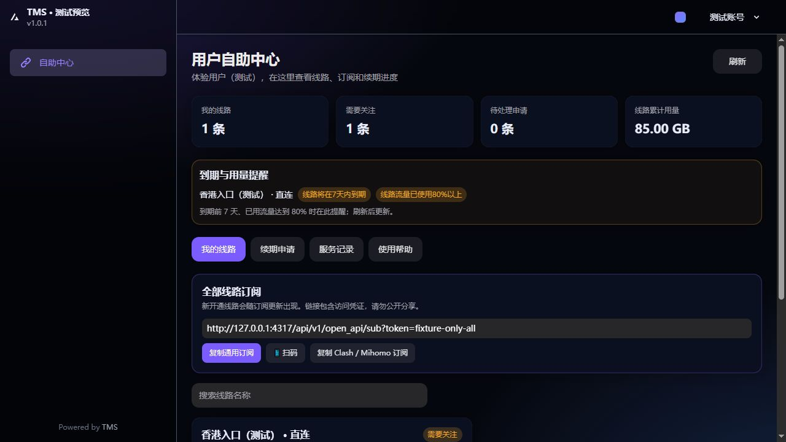
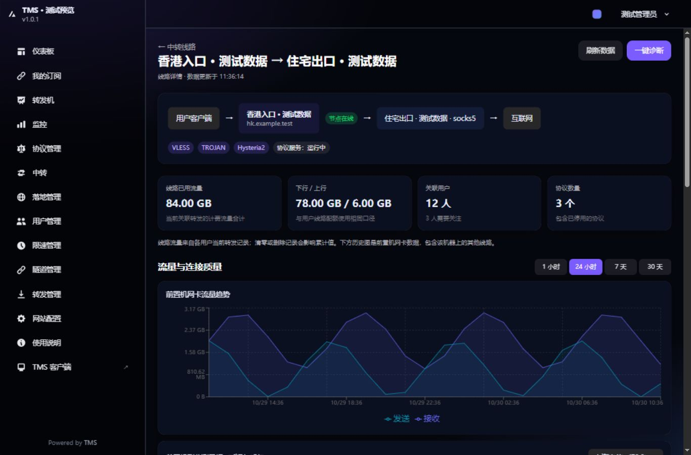
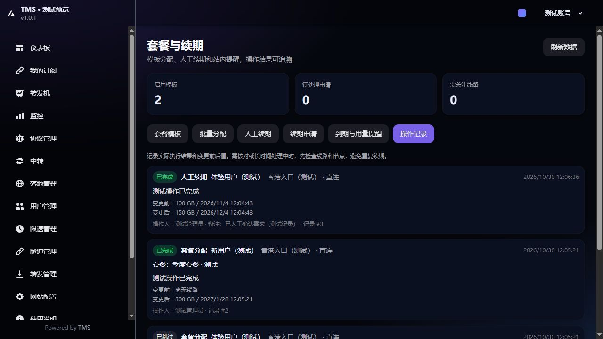

# TMS Service Center

基于 [Teminuosi/Tms](https://github.com/Teminuosi/Tms) 二次开发的线路管理与用户自助面板，集中管理协议、转发、用户配额、套餐分配和人工续期。

[功能介绍](#功能介绍) · [界面预览](#界面预览) · [源码部署](#源码部署) · [使用流程](#使用流程) · [开发与验证](#开发与验证)

> **当前提供源码，尚未发布本仓库的 Docker 镜像或安装包。**
> 使用本仓库新增功能，请按下方步骤构建前后端。原有 `panel_install.sh`、`docker-compose-v4.yml`、`docker-compose-v6.yml` 仍使用上游资源，不能用于安装本仓库新增功能。

## 功能介绍

| 模块 | 功能 |
| --- | --- |
| 线路详情 | 查看关联用户、当前线路流量、前置机历史流量、监测延迟与丢包，执行一键诊断 |
| 用户自助中心 | 查看线路额度、用量、到期时间，复制订阅或扫码，提交人工续期申请并查看进度 |
| 套餐模板 | 配置直连或中转线路、GB 额度、有效天数、可选限速，支持编辑和停用 |
| 批量分配 | 每批最多 50 人，分配前预览，逐人显示结果，已有相同线路自动跳过 |
| 人工续期 | 增加有效期，保持、追加或设置流量额度，保留已有订阅和已用流量 |
| 站内提醒 | 到期前 7 天、流量使用达到 80%、流量耗尽及账号或线路异常提示 |
| 操作记录 | 记录执行结果、操作人、内部备注及变更前后的额度和到期时间 |
| 原有管理能力 | 多协议、直连与中转、端口转发、用户管理、限速、流量与到期控制 |

支持通用订阅及 Clash / Mihomo 订阅。本版本**不包含在线支付、自动扣费或外部消息推送**。

### 数据与操作说明

- 线路累计流量来自当前关联的转发记录；前置机历史流量和探测数据包含机器层面的信息，不等同于单线路计费或用户端到端质量。
- 一键诊断检查支持的协议监听与落地连接。UDP 协议不会通过 TCP 探测直接判定失败，实际使用仍需客户端验证。
- 续期不会清零已用流量；账号状态、账号总额度和账号到期仍独立生效。
- 提醒在打开或刷新页面时计算，不会自动发邮件、短信或 Telegram。
- 批量分配由浏览器逐项提交。离开页面后，尚未提交的用户不会继续执行；已提交结果保存在服务端。
- 操作显示「需核对」或长时间「处理中」时，先检查记录和节点状态，避免重复增加天数。

完整说明：[线路详情](docs/line-detail.md) · [自助中心、套餐与续期](docs/service-center.md)

## 界面预览

以下截图使用本地测试数据，订阅地址和账号均为演示内容，部分导航文字可能与当前版本略有差异。

### 用户自助中心



<details>
<summary>查看线路详情与操作记录</summary>

### 线路详情



### 续期与分配记录



</details>

## 源码部署

下面使用仓库现有的 [docker-compose-hybrid.yml](docker-compose-hybrid.yml) 构建面板，适合先在独立 Linux 测试机上验收。需要 Git、Docker、Docker Compose 插件及 OpenSSL，构建时需要访问镜像和依赖仓库。

该 Compose 文件使用固定容器名、网络名和数据卷名，数据库镜像为 MySQL 5.7。不要与已有 TMS 实例直接混用，也不要把旧部署目录或数据库当成全新环境初始化。

### 1. 获取本仓库源码

```bash
git clone https://github.com/Rohing1/tms-service-center.git
cd tms-service-center
```

### 2. 创建环境配置

在仓库根目录执行。下列命令只在 `.env` 不存在时创建配置，并生成随机数据库密码和 JWT 密钥：

```bash
if [ ! -f .env ]; then
  umask 077
  cat > .env <<EOF
DB_NAME=gost
DB_USER=gost
DB_PASSWORD=$(openssl rand -hex 24)
JWT_SECRET=$(openssl rand -hex 32)
BACKEND_PORT=6365
FRONTEND_PORT=6366
EOF
fi
```

端口如有冲突，请先修改 `.env`。已有数据库部署必须沿用原数据库凭据，不能随意重新生成密码。`.env` 已被 Git 忽略，请单独妥善备份。

### 3. 构建并启动面板

```bash
docker compose -f docker-compose-hybrid.yml --env-file .env up -d --build
docker compose -f docker-compose-hybrid.yml --env-file .env ps
docker compose -f docker-compose-hybrid.yml --env-file .env logs --tail=100 backend
```

构建和服务启动完成后，访问 `http://服务器IP:6366`；若修改了 `FRONTEND_PORT`，使用实际端口。

全新数据库的默认账号和密码均为 `admin_user`。首次登录后立即修改密码。

初次初始化使用 `gost.sql`。不要在全新库上重复导入 `hybrid-schema-v1.sql` 至 `v3.sql`；它们是旧版本升级文件。后端启动时会为套餐与续期新增四张表，数据库账号需具备相应建表权限，详情见 [部署与存储](docs/service-center.md#部署与存储)。

这套 Docker 部署尚未在真实服务器验收；本地已完成的构建、测试和页面检查见下方「开发与验证」。

### 4. 接入节点和配置域名

在管理端「转发机」中新增节点，使用该节点的安装入口生成命令。**当前节点安装命令和 `install.sh` 仍下载上游 `Teminuosi/Tms` 的 Release**，本仓库尚未提供独立节点发布包。安装前确认目标机器，接入后先验证一条直连和一条中转。

面板配置 HTTPS 时，将反向代理指向前端端口，并转发 WebSocket 升级头。详细配置见 [反向代理说明](docs/反向代理.md)。

### 5. 后续更新

更新前备份数据库与 `.env`。在本仓库目录执行：

```bash
git pull --ff-only origin main
docker compose -f docker-compose-hybrid.yml --env-file .env up -d --build
docker compose -f docker-compose-hybrid.yml --env-file .env logs --tail=100 backend
```

前后端需要一起更新。若本地有未提交修改或分支已分叉，先处理差异；不要用强制重置覆盖自己的配置和代码。

仓库保留的发布工作流包含上游镜像地址和发布链接，尚未完成本仓库的发布适配。镜像工作流已改为手动触发，触发前需检查并调整目标地址。

## 使用流程

### 管理员

1. 在「转发机」「协议管理」或「中转」中准备线路，确认节点可用。
2. 打开「套餐与续期」→「套餐模板」，设置线路、额度、有效天数与可选限速。
3. 在「批量分配」中选择模板和用户，核对预览后执行，查看每位用户的结果。
4. 在「续期申请」中处理用户需求，预览并确认人工续期，或填写不通过的回复。
5. 在「到期与用量提醒」和「操作记录」中查看需要处理的线路及变更记录。

已有相同线路会被跳过；修改模板只影响后续分配。旧的用户管理续期入口也会跳转到新流程。

### 用户

1. 登录后进入「自助中心」，查看线路用量、到期与提醒。
2. 按客户端类型复制通用或 Clash / Mihomo 订阅，或扫码导入。
3. 需要续期时提交申请，写明所需天数或流量。
4. 在「续期申请」查看管理员回复，在「服务记录」查看已执行的变更。

提交申请不会自动修改套餐。处理完成后刷新页面，并在客户端更新订阅。

## 开发与验证

| 组件 | 目录 | 环境 |
| --- | --- | --- |
| 前端 | `vite-frontend` | React、TypeScript、Vite；Dockerfile 使用 Node.js 20.19.0 |
| 后端 | `springboot-backend` | Spring Boot、MyBatis Plus；Java 21、Maven 3.9 |
| 节点 | `go-gost` | Go；版本以 `go.mod` 的 `go` / `toolchain` 声明为准 |
| 移动端源码 | `android-app`、`ios-app` | 保留原项目源码，本次功能未做原生客户端发布验证 |

### 前端构建

```bash
cd vite-frontend
npm ci --legacy-peer-deps
npm run build
```

### 后端测试

在仓库根目录执行：

```bash
cd springboot-backend
mvn -Dtest=ServiceCenterServiceTest,ServiceCenterControllerTest,RenewalPolicyTest,LineDetailServiceTest,LineDetailControllerTest test-compile org.apache.maven.plugins:maven-surefire-plugin:3.2.5:test
```

最近一次本地验证（2026-10-30）：

- 前端生产构建通过。
- 23 项后端测试通过，覆盖权限隔离、重复提交、线路互斥、续期规则、申请处理和线路详情。
- 使用临时 H2 数据库与模拟节点，不连接业务数据库。
- 浏览器使用测试数据检查模板创建、批量分配、用户申请、人工续期、记录、手机布局及空白/错误状态。

真实 MySQL、节点配置下发、客户端连通性及完整 Docker 部署仍需在部署环境验收。

## 文档与反馈

- [线路详情与诊断说明](docs/line-detail.md)
- [自助中心、套餐、批量分配与人工续期说明](docs/service-center.md)
- [反向代理与 WebSocket 配置](docs/反向代理.md)
- [提交问题或功能建议](https://github.com/Rohing1/tms-service-center/issues)

反馈时请说明操作步骤、预期结果和错误现象；日志或截图中的订阅 token、节点密钥及数据库密码应先隐藏。

## 致谢与许可证

本仓库基于 [Teminuosi/Tms](https://github.com/Teminuosi/Tms) 二次开发，使用 [go-gost/gost](https://github.com/go-gost/gost) 与 [go-gost/x](https://github.com/go-gost/x) 等开源项目，保留原有版权与许可证文件。

项目根目录许可证为 [Apache License 2.0](LICENSE)；各组件及第三方依赖遵循其各自许可证。项目按许可证所述以现状提供，不作担保，请在合法、获得授权的场景中使用。
